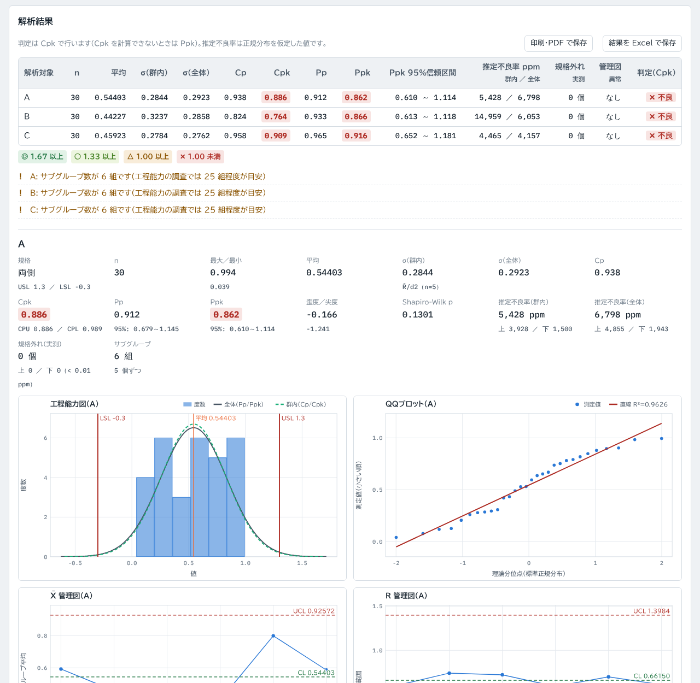
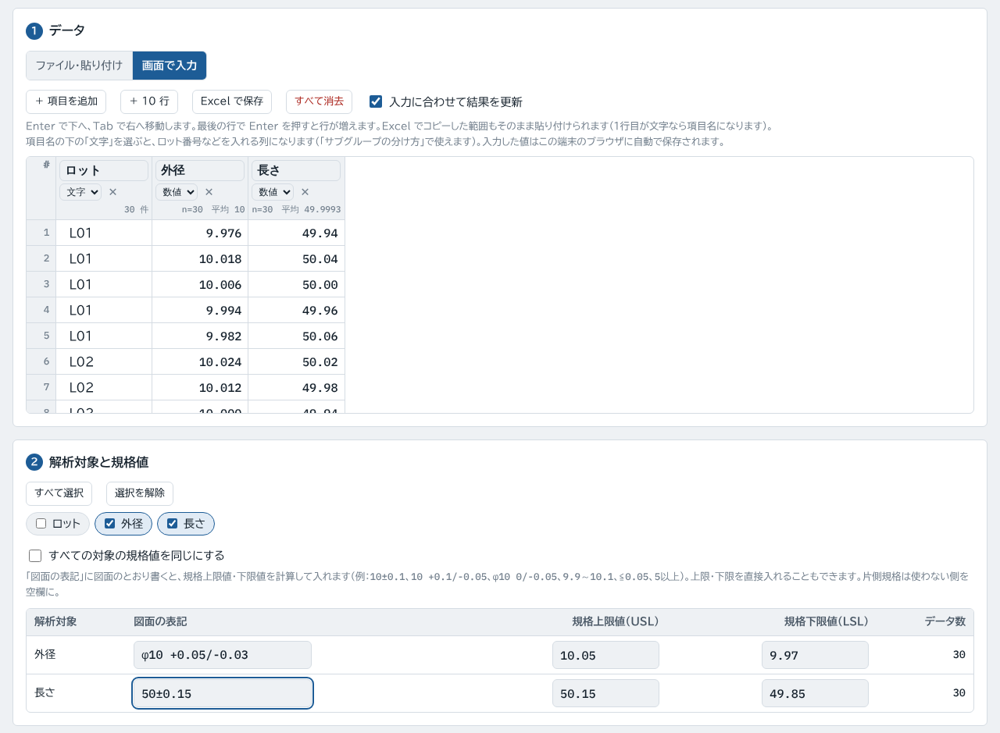
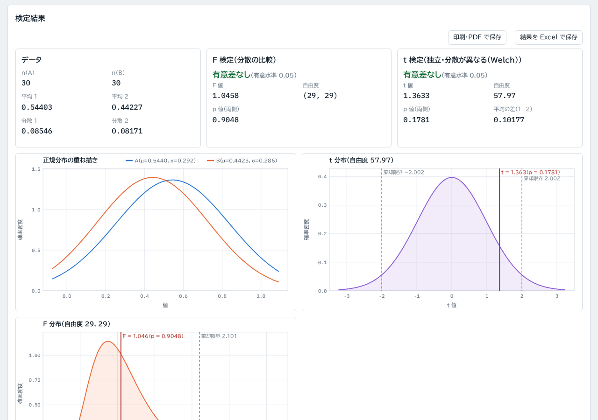
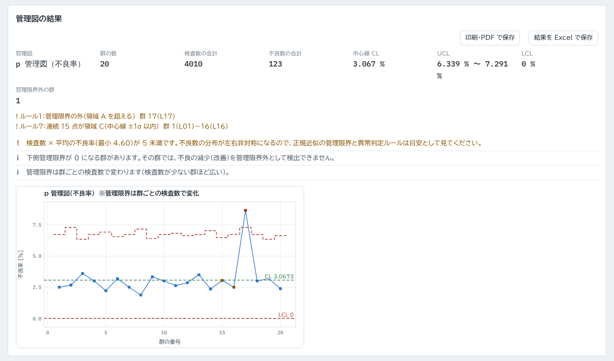
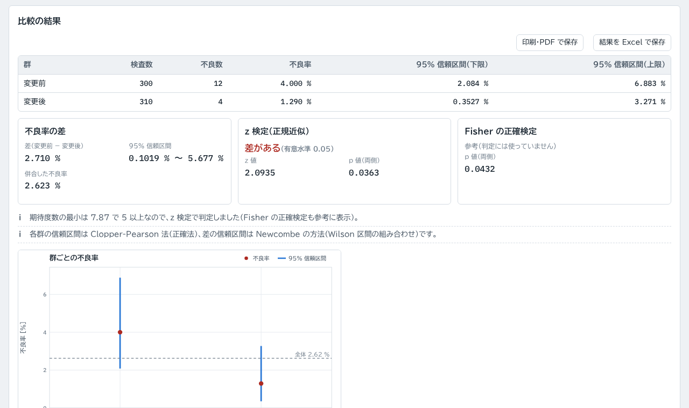

# 工程能力解析（cpk-calc）

Excel の測定データから **Cp・Cpk・Pp・Ppk**、管理図、ヒストグラムなどを計算する Web ツールです。2群の **F検定・t検定・相関** にも対応しています。

**https://kotaooka.github.io/cpk-calc/**

インストールは不要で、ブラウザで開くだけで使えます。

- **データは外に出ません**。ファイルの読み込みと計算はすべてブラウザの中で行い、どこにも送信しません
- 一度開けば**オフラインでも動きます**。スマートフォンやPCにアプリとして追加することもできます

---

## できること

### 工程能力解析

1. **データを入れる**：Excel（.xlsx）か CSV をドラッグするか選択します。**Excel でコピーした範囲をこのページで Ctrl+V しても読み込めます**。**「画面で入力」に切り替えれば、測定値を表に直接入力できます**（入力した値はこの端末のブラウザに自動保存）。「サンプルデータで試す」で動作を確認できます
2. **解析対象と規格値を入れる**：列（または行）を選び、規格を入れます。**図面のとおり「10 +0.1/-0.05」「φ10±0.02」「≦0.05」のように書けば、規格上限値・下限値を計算して入れます**。上限・下限を直接入れることもできます。片側規格は使わない側を空欄にします。シートに「USL」「LSL」（「規格上限」「規格下限」など）という名前の行があれば、規格値として自動で入ります
3. **解析する**：結果の一覧と、対象ごとの統計量・グラフが表示されます

| 出力 | 内容 |
|---|---|
| 工程能力指数 | Cp・Cpk（群内変動）、Pp・Ppk（全体変動）、CPU・CPL、Pp・Ppk の 95% 信頼区間 |
| 不良率 | 推定不良率 ppm（群内・全体、上側・下側）、実際に規格を外れた個数 |
| 統計量 | n、最大・最小、平均、σ(群内)、σ(全体)、歪度、尖度、Shapiro-Wilk 検定の p 値 |
| グラフ | 工程能力図（ヒストグラム＋群内・全体の分布曲線＋規格線）、QQプロット、確率密度分布、X̄-R・s 管理図、I-MR 管理図 |
| 必要なデータ数 | 今の Ppk のまま、95% 信頼区間の下限を「○ 良好」の基準値以上にするのに必要なデータ数。測定前の計画用の計算もできます |
| 管理図の判定 | JIS Z 9020-2 の 8 つの異常判定ルール（当たった点と範囲を表示） |
| 保存 | 結果の Excel ファイル（工程能力・ログ・条件の3シート）、印刷・PDF（対象ごとに1ページ）、グラフの PNG、設定の JSON |

- **サブグループ**は「連続する n 個ずつ」のほか、**ロット番号や日付の列の値で分ける**こともできます。サイズが揃わなくても計算でき、管理限界はサブグループごとのサイズで変わります
- **判定**は Cpk・Ppk・Ppk の 95% 信頼区間の下限から選べ、基準値（初期値 ◎ 1.67 ／ ○ 1.33 ／ △ 1.00）も変えられます

### 2群の検定・相関

2つの列（または行）を選んで、F検定（分散の比較）、t検定（対応あり／独立・等分散／Welch）、相関係数・回帰直線を計算します。t 分布・F 分布の図、正規分布の重ね描き、散布図も出せます。

### 計数値の管理図・不良率の比較

「計数値」タブで次の2つを計算します。

- **計数値の管理図**：群ごとの不良数（欠点数）と検査数（単位数）の列を選び、**p・np・u・c 管理図**を描きます。検査数が群ごとに違っても、p・u 管理図は群ごとの管理限界で描きます。JIS Z 9020-2 の 8 ルールで判定し、結果を Excel に保存できます
- **不良率の比較**：群の検査数と不良数を入れる（Excel から貼り付け可）と、各群の不良率と信頼区間（Clopper-Pearson 法）を出し、2 群なら **z 検定・Fisher の正確検定**と差の信頼区間（Newcombe の方法）、3 群以上なら **χ² 検定**で差を調べます。データの読み込みは不要です

---

## 計算の定義

- **Cp・Cpk** は群内変動 σ(群内) で計算します。サブグループサイズ 2 以上は R̄/d2、1 は MR̄/d2（d2 = 1.128）です
- **Pp・Ppk** は全データの標準偏差 s で計算します
- 片側規格では Cp・Pp は計算せず、Cpk・Ppk に規格がある側の値（CPU・CPL）を表示します
- σ(群内) は**データが測定（生産）順に並んでいる前提**で求めます。並び順に意味がないデータでは Pp・Ppk を見てください

定義は AIAG SPC マニュアルに合わせています。詳しくはツールの「解説」タブを見てください。

---

## 使うときの注意

- **旧形式の .xls は読めません**。Excel で .xlsx に保存し直してください
- 読み込むのは各シートのセルの値です。数式は Excel が保存した計算結果を使います。日付は Excel の内部の数値（シリアル値）のまま扱います
- CSV は UTF-8 と Shift_JIS に対応しています
- 計算結果は判断材料としてお使いください

---

## 計算の検証

統計計算は外部ライブラリを使わずに実装し、scipy・pandas の値と照合するテストを付けています（push のたびに GitHub Actions で実行）。

- 正規分布・t 分布・F 分布・カイ二乗分布の確率と分位点、Shapiro-Wilk 検定、歪度・尖度、F検定・t検定（3種）・相関
- 工程能力指数（サブグループサイズ 1〜10 × 両側・上側・下側 × 標準偏差の計算方法）
- 管理図の係数 d2 を数値積分で求め直して照合
- 計数値の管理図（p・np・u・c の中心線・管理限界）、不良率の信頼区間（Clopper-Pearson・Wilson）、z 検定・Fisher の正確検定・Newcombe の差の信頼区間、k 群の χ² 検定
- Excel の読み込み（openpyxl で読んだ値との全セル照合）と書き出し（openpyxl で読めることを確認）

### 公開されている例題・認証値との照合

上の照合は「自分で別に計算した値」との比較です。これとは別に、答えが公開されているものでも確かめています（`tests/published.js`、push のたびに実行）。出典はいずれも米国国立標準技術研究所（NIST）の公開資料です。

| 計算 | 出典 | 結果 |
|---|---|---|
| 平均・標準偏差（Pp・Ppk に使う s） | [NIST StRD](https://www.nist.gov/itl/products-and-services/statistical-reference-datasets) の一変量データ 7 組（PiDigits、Mavro、Michelso、NumAcc1〜4。最大 5,000 点） | 平均は 14 桁以上、標準偏差は 8〜15 桁一致 |
| 工程能力指数 | [e-Handbook 6.1.6](https://www.itl.nist.gov/div898/handbook/pmc/section1/pmc16.htm) の数値例（USL 20、LSL 8、平均 16、標準偏差 2） | Cp 1.0、Cpk 0.6667、Cpu 0.6667、Cpl 1.3333 で一致 |
| X̄-R 管理図の係数 A2・D3・D4 | [e-Handbook 6.3.2.1](https://www.itl.nist.gov/div898/handbook/pmc/section3/pmc321.htm) の係数表（n = 2〜10） | 27 個中 25 個が一致。D4 の n = 3・5 だけ 0.001 違う（下記） |
| I-MR 管理図 | [e-Handbook 6.3.2.2](https://www.itl.nist.gov/div898/handbook/pmc/section3/pmc322.htm) の数値例（流量 10 バッチ） | 移動範囲、x̄ 50.81、MR̄ 1.8778、UCL 55.8041、LCL 45.8159 で一致 |
| c 管理図 | [e-Handbook 6.3.3.1](https://www.itl.nist.gov/div898/handbook/pmc/section3/pmc331.htm) の数値例（ウェハー 25 枚の欠点数） | c̄ 16、UCL 28、LCL 4 で一致 |

- 一致桁数の 15 前後が、パソコンの計算（倍精度）で出せる限界です。標準偏差の 8〜9 桁（NumAcc3・4）は、10000000.2 のような値を読み込んだ時点の丸め誤差で決まる上限で、ツールはその上限まで一致しています。実際の測定値でこの桁数が問題になることはありません
- **係数表の D4 の違い**：ツールは AIAG SPC マニュアルの値 n = 3 で 2.574、n = 5 で 2.114 を使っています。NIST の表は 2.575・2.115 です。正確な値（1 + 3d3/d2）は 2.574591…・2.114499… で、4 桁に丸めると n = 3 は NIST の 2.575、n = 5 は AIAG の 2.114 が正しい値です。どちらの表も 1 か所ずつ 4 桁目が丸めとずれています。どちらの値を使っても R 管理図の上方管理限界の差は 0.04〜0.05% なので、AIAG に合わせたままにしています
- e-Handbook 6.1.6 の数値例は平均と標準偏差だけが示されているので、平均 16・標準偏差 2 になる 2 点を入れ、全体の標準偏差による指数（Pp・Ppk）で確かめています

開発者向けの情報は [DEVELOPMENT.md](DEVELOPMENT.md) にあります。

## ライセンス

[MIT License](LICENSE)
